  

  
  
  

---

### Hi, I'm Angel 👋

I'm a software developer who works across the whole stack, from server logic to the interface people actually use. I care about software that is clear, maintainable, and genuinely useful to the people who depend on it. I also hold a UX design certificate from Google (Coursera), so I think about the user as much as the code behind them.

- **Web:** React, Next.js, TypeScript, modern JavaScript, and Node.js.
- **Backend & integration:** REST APIs, data modeling, databases, and services that connect systems.
- **Industrial software:** Building and maintaining software for manufacturing operations, including material transfers, inventory, and batch traceability.
- **Always learning:** Self-taught, and comfortable working from technical documentation.

---

### Featured Projects

**[Personal Portfolio](https://portfolio-angel-lozano.vercel.app/)**
Personal site built with modern web tooling and deployed on Vercel.

**File Upload & Management Platform** (Estancia Cinvestav, Tamaulipas)
Frontend and backend work, with validation and services for exchanging information.

**Admin Dashboard for Clients, Employees, Routes & Sales** (Multigas)
Web interfaces built with reusable components and a clean communication layer with the backend.

---

### Stack

  

  
  
  
  

---

  Open to software development opportunities, web projects, and industrial software collaborations.

